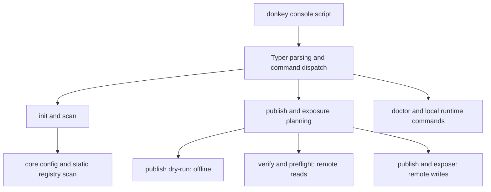

# CLI Architecture

Maintainer-facing explanation of the shipped `donkey` CLI, reviewed against
`27d7e6a25d3c79052ee1b013a5dfb3915d488c2a` on 2026-11-14. This is not a new
architecture invariant or a claim that milestone 28 has shipped. The
[consumer CLI reference](https://docs.donkey-kit.dev/cli) explains usage;
[CLI design guidance](cli-design.md) explains the review and testing bar.
Implementation plans and unresolved decisions belong in
[milestone 28](https://github.com/Donkey-Development-Kit/donkey-development-kit/milestone/28),
not this file. Scope follows BG §1.9, BG §2.5 and BG §2.9.

## Entry Point And Layers

The console script in `python/pyproject.toml` is
`donkey = "donkey_kit.cli:main"`. `cli/__init__.py` imports `_app` first, then
imports command modules for their registration side effects. `_app.app` is the
single Typer application; `expose.py` registers both `expose` and `preflight`.
This is eager command registration, not dynamic plugin discovery.

**Command execution boundaries**

`cli` is the highest package layer and may call the SDK's lower layers. No
library module may import it back. Typer and Rich belong to `[cli]`, never the
base SDK import path. Import-linter forbids library imports of `donkey_kit.cli`
and explicitly forbids `core` from importing Typer or Rich. It does not prohibit
every other library layer from importing those dependencies directly; keeping
terminal concerns out of those layers is also a review responsibility. The
existing contracts are documented in
[the package architecture](../ARCHITECTURE.md#layered-architecture).

Command functions own arguments, stream rendering and exit statuses. Domain
models and validation remain in `core` and `registry`: no Typer contexts or
terminal formatting should enter those layers. Reuse a small helper when
behavior genuinely repeats; a command bus, plugin system or new generic
service layer is not required by onboarding.

## Module Responsibilities

Paths below are relative to `python/src/donkey_kit/`.

| Module and symbol | Responsibility |
| --- | --- |
| `cli/_app.py`: `app`, `_global`, `main` | Registration, global options, version output and a final `DonkeyError` boundary. |
| `cli/_common.py`: `document`, `print_issues`, `ci_source` | Publication document adaptation, issue rendering and optional CI attribution. Not a universal output schema. |
| `cli/init.py`: `init`, `_render_toml`, `_checked` | Resolve connection configuration, render an explicit non-secret allowlist (auth mode included) into escaped project TOML, refuse credential-bearing URLs, and validate the complete candidate before writing. |
| `cli/_files.py`: `check_destination`, `create_new`, `replace` | CLI-only destination policy and staged publication for generated files: no symlink/directory/secret-holder targets, no-clobber creation, mode-preserving same-directory replace. |
| `cli/scan.py`: `scan` | Render `registry.scan.scan` results without executing application code. |
| `registry/scan.py`: `scan`, `ScanResult` | AST discovery, literal declaration validation and project service metadata. |
| `registry/publish_plan.py`: `plan_publication`, `PublishPlan` | Offline publication validation and deterministic asset planning. |
| `registry/expose_plan.py`: `plan_exposure`, `ExposePlan` | Validate and select one service for exposure through an existing gateway. |
| `cli/publish.py`: `publish`, `_publish` | Plan first, then execute publication through a `Runtime` only for a live run. |
| `cli/verify.py`: `verify` | Compare published assets with their live service, using existing verification APIs. |
| `cli/expose.py`: `_run`, `_expose` | Shared exposure/preflight path; read-only or additive live execution. |
| `cli/doctor.py`: `doctor`, `_probe_checks` | A real governed LLM probe and evidence-based diagnostic checks. |
| `cli/mock.py`, `cli/dev.py`, `cli/test.py` | Simulator, A2A local development and pytest front ends; these are not static scanning. |
| `cli/_blocked.py` | Hidden, verification-blocked `status`; no invented platform calls. |

Async command operations are bridged with `asyncio.run`; the command helpers
that own a `Runtime` close it in `finally`. Optional framework/server/test
dependencies must remain deferred until execution, so command help is available
without those extras. `dev` and `test` intentionally load user targets; the
static scanner does not.

## Configuration And Paths

`DonkeyConfig.resolve` owns per-field precedence: explicit overrides,
environment variables, project-local overlay, project file, user file, defaults.
It also owns endpoint provenance and credential trust. A renderer must not
duplicate these rules or bypass them by reconstructing a runtime configuration.

Current global options go **before** the command. `--config` selects the output
for `init` (never read as its input), but the input project file for `doctor`. Other commands reject it.
`--env` applies globally only to `init`; exposure commands have their own local
`--env`. `--json` is global, and several commands also accept it locally.
`--version` is eager plain-text output, not a JSON document.

Current `init` resolves from the working directory via `DonkeyConfig.from_env()`:
the `--config` destination does not select its input. It returns successfully
without resolving configuration or changing an existing file unless `--force`
requests regeneration.
Regeneration replaces the entire document, including any unrelated declarations;
it is not a merge, and `init` names the dropped tables on stderr. Since #1746 the
write is staged in the destination directory and published by `os.link`
(creation: a file that appears meanwhile is never clobbered) or `os.replace`
(regeneration: atomic for readers, last writer wins against a concurrent editor).
The final destination component may not be a symlink, a directory or a
secret-holder name, with or without `--force`; ancestor symlinks are allowed.

For scan/publication/exposure, PATH is a directory or a single Python file.
Current declaration readers load `.donkey-kit.toml` at that root or file's
parent, then merge the adjacent `.donkey-kit.local.toml` over it key by key.
They do not read user-wide declaration tables. Publication always separately
resolves connection config, even for `--dry-run`, using the working directory's
project config when the scanned project file is absent. Environment variables
and user config also participate, and the resolved `org_id` supplies the plan's
default group ID. The same source tree can therefore produce different offline
plans in different shells; offline does not mean context-free. This is not the
declaration merge. These distinctions must be made
explicit before adding scaffold output selection: a non-default scan root must
not silently acquire the working directory's declarations, and an overlay-free
scaffold must not reuse the current merged readers without separating inputs.

## Side Effects And Readiness

| Command | Network | Writes or executes |
| --- | --- | --- |
| `init` | No | Creates missing destination parent directories and writes a connection config file; resolves existing config sources only on the write path. An existing target without `--force` returns before resolution; an unsafe destination is refused first. |
| `scan` | No | No writes; AST parsing and declaration reads only. |
| `publish --dry-run` | No | No writes; offline publication plan. |
| `publish` | Yes | Publishes assets and associated metadata. |
| `verify` | Yes | Remote reads and service comparisons. |
| `preflight`, `expose --dry-run` | Yes | Remote reads; neither means offline. |
| `expose` | Yes | Additive publication, API instance/policy/deployment operations under ADR 0015. |
| `doctor` | Yes | A real model request, potentially consuming tokens or budget. |
| `mock`, `dev` | Local listener | Starts a server; `dev` executes an imported application target. |
| `test` | Depends on test selection | Executes pytest and the user's selected test/agent code. |

Valid TOML, a clean static scan, a complete publication declaration, and a
reachable or governed service are different facts. An MCP server may scan
cleanly without a transport. Agent publication can legitimately use protocol
`other`; A2A verification/exposure needs its more specific declarations.
Readiness must respect the selected workflow instead of inventing one universal
required-field list. Unknown or untested facts must stay unknown.

`scaffold` does **not** exist in this reviewed revision. Milestone 28 proposes
offline candidates from the existing scanner, safe declaration writes and
workflow-scoped readiness. Those plans must not be marketed as installed
commands until implementation and published-package acceptance land.

## Output And Failure Contracts

Commands already have distinct machine contracts: `scan_format`, `plan_format`,
`publish_format`, `verify_format` and `expose_format`, currently version 1.
`init` and `doctor` do not carry those format keys. Do not silently wrap all
existing documents in a new envelope.

Declaration failures generally produce the command's JSON document and exit 1.
`scan` uses exit 2 for a missing path; malformed declarations are scan issues
with exit 1. Publication/verification/exposure commands use exit 2 for missing
paths or invalid connection config, without a document. Named exceptions are
`doctor`, which exits 1 on config failures, and `init`, whose command body has
no exit-2 path: write failures and refused destinations or values exit 1 to stderr without a JSON document, and escaping `DonkeyError` is handled by
`main`. Parser/global-option usage errors may still exit 2 before those command
bodies run. The precise command contract wins over a proposed global rule.
Hidden `status` exits 3; `test` forwards pytest's exit status. `_app.main` handles otherwise
escaping `DonkeyError` as stderr plus exit 1, not a universal JSON error handler.

The 2026-11-14 review found gaps, not new supported behavior: `init` string
escaping and destination protection (closed by #1746, which also refuses
credential-bearing URLs in what `init` writes), credential-bearing public URLs
elsewhere, decoding errors escaping config handling, static scanner ambiguity, and `doctor`'s
false-green fallback. Their remediation is recorded in issues #1746 through
#1751. Passing existing tests does not establish that those cases are safe.

## Maintaining This Map

Update this explanation when registration, paths, dependency boundaries,
workflow effects or output contracts change. CLI changes should explicitly
review this map alongside the consumer docs to prevent the dated baseline from
silently drifting. Update consumer examples in `website/content/cli.mdx` by
hand, and regenerate only its `cli-reference` command-reference region with
`python/scripts/generate_docs.py`. Published-surface changes also
need the sibling acceptance harness; contributor docs are not a substitute.

Changing an invariant, dependency policy or import-linter contract requires a
new [ADR](adr/README.md). Describing the current design and documenting
issue-owned improvements changes none of those contracts.
