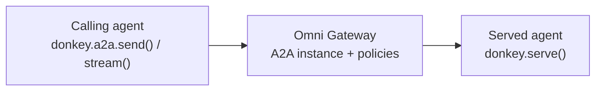

import { Card, CardGrid } from '../../components'

# A2A agents

DDK covers both directions of agent-to-agent (A2A) traffic through Omni Gateway:

- **Inbound.** Your agent serves A2A behind the gateway, so other agents can call
  it. `donkey.serve()` runs the listener, `donkey expose` registers the gateway
  ingress for it, and `donkey dev` puts a simulated gateway in front of your
  laptop.
- **Outbound.** Your agent calls another governed A2A agent.
  `donkey.a2a.send()` and `donkey.a2a.stream()` resolve the agent from the
  registry and delegate through the official `a2a-sdk`.

Either way, the gateway applies the A2A policies configured on the agent's API
instance, and DDK turns the outcomes it can identify into typed exceptions.

## Pick your path

| I want to… | Go to | What you use |
| --- | --- | --- |
| Make my agent callable by other agents | [Serve & expose](/a2a/serve) | `donkey.serve()`, `donkey expose`, `donkey dev` |
| Call a governed agent from my agent | [Call other agents](/a2a/call) | `donkey.a2a.send()`, `donkey.a2a.stream()` |
| Know what the gateway can enforce, and what my code sees | [Gateway policies](/a2a/gateway-policies) | Typed refusals, challenges and replay |

Each page carries its own status badge. The A2A facade is provisional, and
successful gateway send and SSE are not live verified yet; see
[Call other agents](/a2a/call) for the exact boundary.

## Supported frameworks

A2A is not bound per framework. `donkey.a2a.send()`, `donkey.a2a.stream()` and
`donkey.serve()` are the same for every framework, so an agent built with any of
the eight can call or serve other agents.

| Framework | Call another agent | Serve your agent |
| --- | --- | --- |
| [LangGraph](/frameworks/langgraph) | `donkey.a2a.send()` / `stream()` | `donkey.serve()` |
| [Google ADK](/frameworks/adk) | `donkey.a2a.send()` / `stream()` | `donkey.serve()` |
| [Strands](/frameworks/strands) | `donkey.a2a.send()` / `stream()` | `donkey.serve()` |
| [MS Agent Framework](/frameworks/agent-framework) | `donkey.a2a.send()` / `stream()` | `donkey.serve()` |
| [OpenAI Agents SDK](/frameworks/openai) | `donkey.a2a.send()` / `stream()` | `donkey.serve()` |
| [Anthropic SDK](/frameworks/anthropic) | `donkey.a2a.send()` / `stream()` | `donkey.serve()` |
| [CrewAI](/frameworks/crewai) | `donkey.a2a.send()` / `stream()` | `donkey.serve()` |
| [LlamaIndex](/frameworks/llamaindex) | `donkey.a2a.send()` / `stream()` | `donkey.serve()` |

Binding an A2A agent as a framework-native tool (`as_tool()`) is planned, not
shipped; see [Call other agents](/a2a/call). The full map across all three
surfaces is on [Supported frameworks](/supported-frameworks).

## A2A across the docs

Other sections cover A2A where it meets their topic:

- **Typed refusals:** [JSON-RPC refusal matching](/errors#json-rpc-refusal-matching)
  covers the A2A refusal shapes `classify()` types.
- **Local simulator:** [outbound A2A fault injection](/simulator/a2a#outbound-a2a-fault-injection)
  and [A2A ingress replay](/simulator/a2a#a2a-ingress-replay).
- **Human-in-the-loop:** [A2A Authorization-Code Challenges](/hitl/gateway-step-up#a2a-authorization-code-challenges).
- **Observability:** [outbound A2A spans](/telemetry#outbound-a2a-spans) and
  [correlation across agent hops](/correlation#across-agent-hops).
- **Scan & publish:** [publishing agents](/publishing#publishing-agents) and
  [declaring how an agent is reached](/publishing#declaring-how-an-agent-is-reached).
- **CLI:** [`donkey expose`](/cli/ship#donkey-expose) and [`donkey dev`](/cli/local#donkey-dev).
- **Reference:** [connected-app scopes for `donkey expose`](/reference/scopes#for-donkey-expose),
  the [unsupported boundary](/reference/unsupported-boundary#current-boundary),
  and the Python API for [`donkey.serve()`](/reference/api#donkeyserve) and
  [`donkey.a2a`](/reference/api#donkeya2a).

## Next steps

<CardGrid columns={3}>
  <Card title="Serve & expose" href="/a2a/serve">
    Serve your agent in one line, then expose it through the gateway.
  </Card>
  <Card title="Call other agents" href="/a2a/call">
    Send and stream through a registry-pinned gateway endpoint.
  </Card>
  <Card title="Gateway policies" href="/a2a/gateway-policies">
    Captured outcomes, challenges and replay, per protocol version.
  </Card>
</CardGrid>
