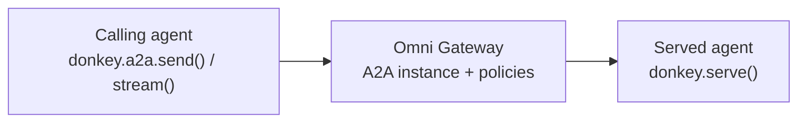

# A2A agents

Status: Offline-verified. Shipped and verified offline; no live gateway round-trip yet.

DDK covers both directions of agent-to-agent (A2A) traffic through Omni Gateway:

- **Inbound.** Your agent serves A2A behind the gateway, so other agents can call
  it. `donkey.serve()` runs the listener, `donkey expose` registers the gateway
  ingress for it, and `donkey dev` puts a simulated gateway in front of your
  laptop.
- **Outbound.** Your agent calls another governed A2A agent.
  `donkey.a2a.send()` and `donkey.a2a.stream()` resolve the agent from the
  registry and delegate through the official `a2a-sdk`.

Either way, the gateway applies the A2A policies configured on the agent's API
instance, and DDK turns the outcomes it can identify into typed exceptions.

## Pick your path

| I want to… | Go to | What you use |
| --- | --- | --- |
| Make my agent callable by other agents | [Serve & expose](https://docs.donkey-kit.dev/a2a/serve.md) | `donkey.serve()`, `donkey expose`, `donkey dev` |
| Call a governed agent from my agent | [Call other agents](https://docs.donkey-kit.dev/a2a/call.md) | `donkey.a2a.send()`, `donkey.a2a.stream()` |
| Know what the gateway can enforce, and what my code sees | [Gateway policies](https://docs.donkey-kit.dev/a2a/gateway-policies.md) | Typed refusals, challenges and replay |

Each page carries its own status badge. The A2A facade is provisional, and
successful gateway send and SSE are not live verified yet; see
[Call other agents](https://docs.donkey-kit.dev/a2a/call.md) for the exact boundary.

## A2A across the docs

Other sections cover A2A where it meets their topic:

- **Typed refusals:** [JSON-RPC refusal matching](https://docs.donkey-kit.dev/errors.md#json-rpc-refusal-matching)
  covers the A2A refusal shapes `classify()` types.
- **Local simulator:** [outbound A2A fault injection](https://docs.donkey-kit.dev/simulator/a2a.md#outbound-a2a-fault-injection)
  and [A2A ingress replay](https://docs.donkey-kit.dev/simulator/a2a.md#a2a-ingress-replay).
- **Human-in-the-loop:** [A2A Authorization-Code Challenges](https://docs.donkey-kit.dev/hitl.md#a2a-authorization-code-challenges).
- **Observability:** [outbound A2A spans](https://docs.donkey-kit.dev/telemetry.md#outbound-a2a-spans) and
  [correlation across agent hops](https://docs.donkey-kit.dev/telemetry.md#across-agent-hops).
- **Scan & publish:** [publishing agents](https://docs.donkey-kit.dev/publishing.md#publishing-agents) and
  [declaring how an agent is reached](https://docs.donkey-kit.dev/publishing.md#declaring-how-an-agent-is-reached).
- **CLI:** [`donkey expose`](https://docs.donkey-kit.dev/cli.md#donkey-expose) and [`donkey dev`](https://docs.donkey-kit.dev/cli.md#donkey-dev).
- **Reference:** [connected-app scopes for `donkey expose`](https://docs.donkey-kit.dev/reference/scopes.md#for-donkey-expose),
  the [unsupported boundary](https://docs.donkey-kit.dev/reference/unsupported-boundary.md#current-boundary),
  and the Python API for [`donkey.serve()`](https://docs.donkey-kit.dev/reference/api.md#donkeyserve) and
  [`donkey.a2a`](https://docs.donkey-kit.dev/reference/api.md#donkeya2a).

## Next steps

  
    Serve your agent in one line, then expose it through the gateway.
  
  
    Send and stream through a registry-pinned gateway endpoint.
  
  
    Captured outcomes, challenges and replay, per protocol version.
